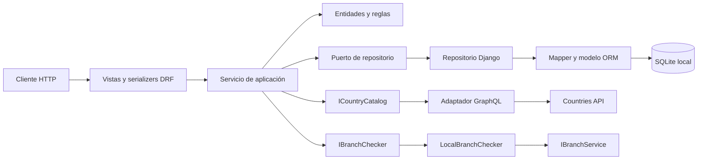

# Arquitectura de GoCargo Demo

## 1. Propósito y alcance

GoCargo Demo es un backend de logística construido con Django y Django REST Framework. Gestiona sucursales locales y registra envíos internacionales después de validar la sucursal de origen, el peso y el país de destino.

El proyecto se organiza como un **monolito modular con arquitectura hexagonal**: una aplicación desplegable, dos módulos de negocio y contratos que separan las reglas internas de HTTP, la base de datos y el proveedor GraphQL.

Este documento describe la implementación actual. Para operar la API consulta el [manual general](manual.md); para estudiar archivos, clases y recorridos consulta el [manual detallado](manual_detallado.md).

## 2. Estructura del proyecto

```text
GoCargo_Demo/
├── .docs/                       # Documentación del proyecto
├── apps/
│   ├── branches/                 # Sucursales
│   │   ├── domain/
│   │   ├── application/
│   │   │   ├── dto/
│   │   │   ├── interfaces/
│   │   │   ├── ports/
│   │   │   └── services/
│   │   ├── infrastructure/persistence/
│   │   ├── presentation/api/
│   │   ├── models/
│   │   ├── migrations/
│   │   └── tests/
│   └── shipments/                # Envíos; agrega adaptadores de integración
├── config/                      # Configuración, composición y rutas generales
│   ├── settings.py
│   ├── dependencies.py
│   ├── urls.py
│   ├── api_exception_handler.py
│   ├── api_docs.py
│   ├── openapi.json
│   └── tests/
├── core/                        # Contratos y persistencia compartidos
├── templates/api_docs.html      # Interfaz Scalar
├── manage.py
├── requirements.txt
├── .env                         # Valores locales privados
└── .env.example                 # Plantilla de configuración
```

`apps/` es una carpeta organizativa. Las apps registradas en Django son `apps.branches` y `apps.shipments`. `core/` es un paquete compartido y no se registra como app: no define tablas propias. `config/` reúne la configuración y el ensamblaje de la aplicación.

## 3. Capas y dirección de dependencias

| Área | Contenido | Dependencias permitidas |
| --- | --- | --- |
| Dominio | Entidades, objeto de valor y excepciones de validación. | Biblioteca estándar y tipos del dominio propio. |
| Aplicación | DTO, interfaces de servicio, puertos y servicios. | Dominio, contratos propios y contratos compartidos de `core/application/`. |
| Infraestructura | Modelos Django, mappers, repositorios, cliente GraphQL y unidad de trabajo. | Contratos internos y librerías concretas necesarias para implementarlos. |
| Presentación | Vistas DRF, serializers, rutas y traducción de errores. | Servicios de aplicación y componentes HTTP. |
| Composición | Fábricas de dependencias. | Las implementaciones y contratos necesarios para conectar el sistema. |

El dominio y la aplicación no importan Django, DRF, `requests`, modelos ORM ni adaptadores concretos. Las vistas no escriben directamente en la base de datos ni consultan el proveedor de países.

Las vistas importan fábricas desde `config/dependencies.py`. Es una decisión de ensamblaje: las fábricas devuelven interfaces de servicio, mientras el conocimiento de repositorios y clientes concretos queda dentro de composición.

## 4. Colaboración durante una solicitud



El diagrama representa llamadas durante la ejecución. En el código, los adaptadores implementan contratos definidos por aplicación; la aplicación no importa esos adaptadores.

## 5. Interfaces y servicios

Cada módulo dispone de una interfaz `Protocol` y una implementación:

| Interfaz | Implementación | Acciones |
| --- | --- | --- |
| `IBranchService` | `BranchService` | `create`, `list_all`, `get_info`, `update`. |
| `IShipmentService` | `ShipmentService` | `create`, `list_all`, `get_by_id`. |

Cada método representa un caso de uso del negocio. No existe otra capa de clases `UseCase` entre el servicio y sus colaboradores.

Las interfaces de servicio viven en `application/interfaces/`; los contratos de salida, en `application/ports/`. Un servicio define qué acciones ofrece el módulo. Un repositorio define qué necesita ese módulo para almacenar y recuperar datos. No se heredan ni se mezclan esas responsabilidades.

`Protocol` expresa contratos mediante tipos y firmas. No genera implementaciones ni sustituye las validaciones de ejecución. Las fábricas inyectan colaboradores por constructor.

## 6. Límites entre módulos

`branches` es propietario del catálogo local de sucursales. `shipments` es propietario de los envíos y sus instantáneas históricas.

La aplicación de envíos consulta `IBranchChecker`. Su adaptador `LocalBranchChecker` recibe `IBranchService`, llama a `get_info()` y convierte `BranchInfoData` en el `BranchInfoDTO` definido por envíos. No consulta directamente la tabla de sucursales.

Esta traducción permite modificar la organización interna de `branches` manteniendo su contrato público. No se necesita una llamada HTTP entre módulos que viven en el mismo proceso.

## 7. Representaciones de datos

| Representación | Ejemplo | Propósito |
| --- | --- | --- |
| Entidad | `Branch`, `Shipment` | Identidad y consistencia del negocio. |
| Objeto de valor | `PackageWeight` | Peso inmutable, válido y con precisión controlada. |
| DTO | `CreateShipmentInput`, `ShipmentData` | Transferencia de datos entre aplicación y sus consumidores. |
| Modelo ORM | `BranchModel`, `ShipmentModel` | Tablas, columnas y restricciones de almacenamiento. |
| Serializer | `CreateShipmentSerializer` | Validar formato HTTP y representar resultados como JSON. |

Los mappers convierten modelos y entidades; no ejecutan escrituras. Por ejemplo, `ShipmentMapper` convierte `PackageWeight.kg` en la columna `weight_kg` y reconstruye el objeto de valor al recuperar un envío.

Esta separación tiene un costo de código y conversiones. En esta demo se adopta para hacer explícita la independencia del núcleo; no se presenta como requisito universal de Django.

## 8. Persistencia e identidad

SQLite es el motor inicial. Las tablas de negocio son `branches` y `shipments`; ambas usan UUID como clave primaria. Django conserva además las tablas de sus apps estándar.

`BaseRepository[T, M]` recibe una clase ORM, un mapper y el alias de conexión. Implementa:

- `save(entity)`: inserta con `force_insert=True`; no actualiza registros existentes.
- `get_by_id(id)`: recupera una entidad o devuelve `None` por ausencia.

Los repositorios específicos agregan listado y, en sucursales, actualización. `DjangoBranchRepository.update()` ejecuta una actualización explícita y devuelve `None` si el registro dejó de existir. No convierte esa ausencia en una inserción.

`origin_branch_id` es una referencia UUID sin FK en `ShipmentModel`. La validación de existencia y estado se hace antes de crear el envío. La base no garantiza por sí sola la integridad de esa referencia.

Las restricciones de base refuerzan capacidad positiva y peso de paquete entre cero exclusivo y 50 kg inclusive. No reemplazan todas las reglas del dominio. Las migraciones se mantienen en `migrations/` de cada app y se generan con Django.

## 9. Transacciones y concurrencia

La creación de envíos valida peso, sucursal y país antes de abrir la unidad de trabajo. Dentro de ella construye y guarda el envío; devuelve el resultado después de salir correctamente del bloque.

`DjangoUnitOfWork` implementa `IUnitOfWork` mediante `transaction.atomic()`. Repositorio y unidad de trabajo usan `DATABASES['default']`. Una excepción que sale del bloque provoca rollback; una salida correcta permite confirmar. La unidad de trabajo no replica el seguimiento de cambios de Entity Framework.

La transacción es local: no bloquea el catálogo remoto ni garantiza que una sucursal no cambie entre consulta y escritura. La actualización de sucursales tampoco implementa versionado ni control optimista de concurrencia. Ante escrituras simultáneas sobre la misma fila, pueden sobrescribirse cambios.

## 10. Integración GraphQL

La integración de países pertenece a infraestructura de envíos y se divide en cuatro piezas:

1. Consulta GraphQL con variables para el código.
2. Cliente HTTP síncrono basado en `requests`, con tiempos de conexión y lectura.
3. Catálogo que distingue ausencia confirmada de respuesta inválida.
4. Mapper que devuelve `CountryDataDTO` y valida los campos externos requeridos.

La implementación rechaza respuestas con `errors`, incluso si contienen datos parciales. Solo `country: null` dentro de una respuesta válida significa país inexistente. Timeout, error HTTP, JSON inválido o datos incompletos se informan como indisponibilidad.

No hay caché, reintentos automáticos ni sincronización de catálogos. Las lecturas de envíos usan únicamente datos locales; no necesitan contactar al proveedor ni comprobar el estado actual de la sucursal.

## 11. Errores y contrato HTTP

La presentación traduce errores propios a códigos HTTP: `400` por formato, `404` por ausencia, `409` por conflicto de persistencia, `422` por reglas y `503` por indisponibilidad. El éxito usa `200` o `201`.

El handler configurado es `shipment_exception_handler`; trata errores de envíos y delega los demás al handler de `config/`, que conoce validaciones de sucursales, persistencia y errores estándar DRF.

Los errores esperados exponen `code` y `detail`; los de validación HTTP pueden agregar `errors`. Los fallos inesperados no se convierten en validaciones: se delegan al tratamiento estándar del framework. Una URL que no coincide con una ruta también puede recibir el `404` estándar de Django.

## 12. OpenAPI, Scalar y configuración

`config/openapi.json` es un contrato local mantenido explícitamente. `/api/schema/` lo sirve como JSON y `/api/docs/` renderiza Scalar con una plantilla Django. No se utiliza un generador automático de esquema.

La interfaz Scalar se descarga desde jsDelivr en el navegador; sus solicitudes de API se realizan contra el servidor local, sin proxy externo. Si falla el CDN, el esquema JSON sigue disponible.

`python-dotenv` carga `.env` desde `settings.py`. Las variables externas tienen prioridad. `config/dependencies.py` lee configuración Django para construir el cliente HTTP; ni dominio ni aplicación leen archivos de entorno.

## 13. Pruebas y evolución

Las 64 pruebas actuales cubren dominio, servicios, persistencia, rollback, integración entre módulos, contrato GraphQL, API y documentación. El catálogo se sustituye en la suite y la base de pruebas se mantiene separada de la base local de desarrollo.

El siguiente criterio guía las extensiones: las acciones nuevas se agregan a la interfaz y servicio del módulo; la infraestructura necesaria se expresa mediante puertos; el esquema OpenAPI y las pruebas se actualizan junto con el endpoint.

Cambiar a PostgreSQL o SQL Server requiere comprobar backend, drivers, versiones, migraciones, traslado de datos y diferencias de restricciones y transacciones. Las interfaces buscan proteger reglas y contratos de aplicación, pero no garantizan una migración automática ni compatibilidad ya validada.

Los listados actuales materializan todos los registros y no tienen paginación. No hay autenticación de negocio, eliminación, edición de envíos, procesamiento asíncrono ni control avanzado de concurrencia. Son límites explícitos de una demo pequeña, no capacidades ya resueltas por tener capas.
